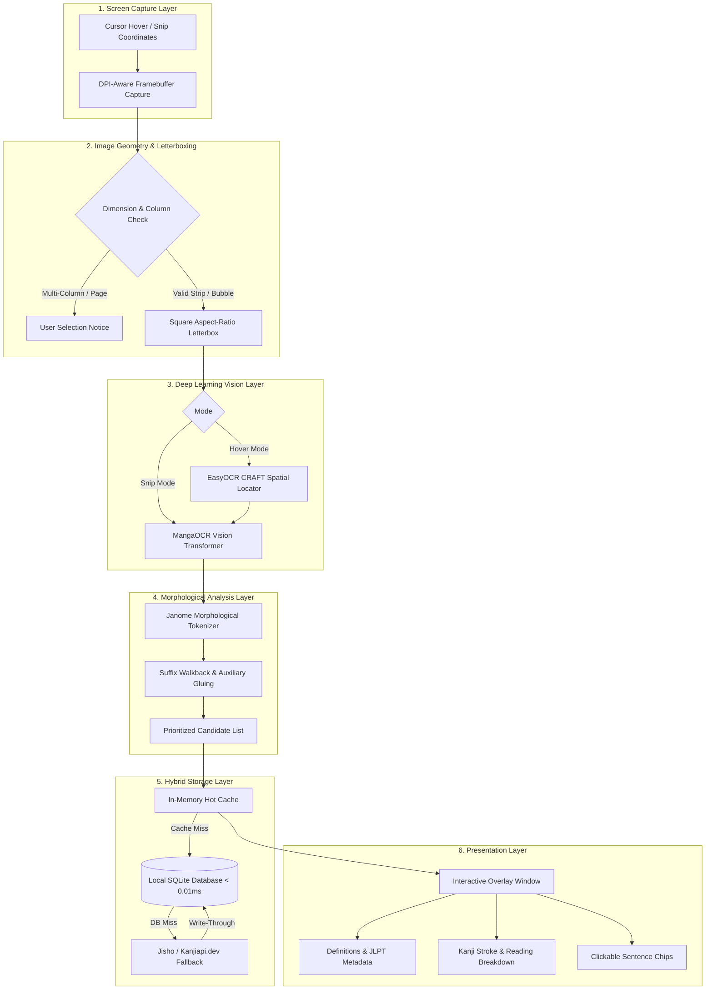

# Japanese Desktop OCR Pop-up Dictionary

[](https://github.com/Bogdan-NBC/Japanese-dictionary/actions/workflows/ci.yml)
[](https://www.python.org/)
[](https://github.com/astral-sh/ruff)
[](https://opensource.org/licenses/MIT)
[]()

A desktop optical character recognition (OCR) and local-first dictionary overlay designed for reading Japanese digital manga (BookWalker, ComicWalker), vertical light novels, visual novels, and native desktop applications.

---

## Overview

Browser-based pop-up tools such as Yomichan and 10ten Japanese Reader rely on DOM text extraction, which is unavailable in desktop readers, visual novels, or DRM-protected manga readers where text is rendered directly to an image or canvas.

This project addresses this limitation through a multi-stage desktop pipeline:
1. **Screen Capture**: DPI-aware region capture handling multi-monitor Windows environments.
2. **Vision & OCR**: Vision Transformer (ViT) character recognition optimized for styled and vertical text (*tategaki*).
3. **Morphological Analysis**: Morphological tokenization and suffix de-inflection (Janome) to map conjugated verbs and adjectives to dictionary headwords.
4. **Local-First Storage**: High-speed, offline-first SQLite dictionary engine (< 0.01 ms lookups) with asynchronous fallback to remote dictionary APIs.
5. **Interactive UI**: A floating Tkinter overlay that tokenizes full sentences into clickable word chips for rapid reading.

---

## Key Technical Features

### Low-Latency Phased Startup
Model loading is decoupled into two phases:
- **Phase 1 (Screen Snip Engine)**: MangaOCR and Janome load in under 1.8 seconds on a CUDA-capable GPU, enabling snip functionality and global hotkeys (`Alt+S`) immediately.
- **Phase 2 (Hover Engine)**: EasyOCR (CRAFT detector) initializes asynchronously in the background, eliminating blocking startup delays without GPU context contention.

### Vision Transformer Aspect-Ratio Preservation
Vision Transformers require square input grids (typically 224x224 pixels). Resizing elongated vertical novel strips directly into square inputs stretches characters horizontally and compresses them vertically, degrading character strokes into unreadable noise.
The preprocessing pipeline applies dynamic square letterboxing: it samples background pixel colors and pads vertical strips to a 1:1 aspect ratio prior to inference.

### Multi-Column Paragraph Protection
Autoregressive language decoders hallucinate conversational filler when supplied with scrambled inputs. Slicing horizontally across multiple columns combines unrelated vertical sentences. The snip canvas applies tiered geometric heuristics:
- Multi-column novel blocks (> 70px width, > 400px height) trigger actionable guidance prompting single-column selection.
- Full-page selections (> 450x450px) trigger a notification preventing unnecessary neural network inference.

### Local-First SQLite Dictionary Engine
- Built-in SQLite database operating in Write-Ahead Logging mode (`PRAGMA journal_mode=WAL`) with in-memory caching.
- Queries execute locally in less than 0.01 milliseconds.
- New entries resolved via remote APIs (Jisho.org, Kanjiapi.dev) are persisted through write-through caching for future offline use.
- Dedicated importer script processes full JMdict (~185,000 terms) and KANJIDIC2 (~13,100 characters) databases.

### Morphological Analysis & Lemma Recovery
- Tokenizes sentences into interactive chips using Janome.
- Implements suffix walkback algorithms: when an auxiliary verb or inflection suffix is selected, the analyzer recovers the dictionary stem form (e.g. `食べさせられなかった` -> `食べる`).
- Glues auxiliary verbs (`〜ている`, `〜ておく`, `〜ない`, `〜ます`) into coherent lexical units.

---

## Architecture



---

## Getting Started

### Prerequisites
- Python 3.10 or higher
- Windows 10/11 (Linux supported for core OCR, NLP, and database components)
- NVIDIA GPU with CUDA recommended; automatic CPU fallback is supported

### Installation

1. **Clone the repository**:
   ```bash
   git clone https://github.com/Bogdan-NBC/Japanese-dictionary.git
   cd Japanese-dictionary
   ```

2. **Create and activate a virtual environment**:
   ```bash
   python -m venv .venv
   # Windows (PowerShell):
   .venv\Scripts\Activate.ps1
   # Linux / macOS:
   source .venv/bin/activate
   ```

3. **Install dependencies**:
   ```bash
   pip install -e .
   ```

4. **Populate the offline dictionary (Optional but recommended)**:
   ```bash
   # Seeds initial vocabulary (~500 core words and kanji)
   python scripts/seed_starter_dictionary.py

   # Or import full JMdict and KANJIDIC2 (~185,000 words, ~13,100 kanji)
   python scripts/import_jmdict.py
   ```

5. **Run the application**:
   ```bash
   jp-ocr-dict
   # Or alternatively:
   python src/jp_ocr_dict/main.py
   ```

---

## Key Shortcuts and Usage

| Shortcut | Action | Description |
|---|---|---|
| `Alt + S` | Toggle Screen Snip | Freezes screen; drag across any speech bubble or text line to translate. |
| `Alt + E` | Toggle Hover OCR | Starts background hover scanning near the mouse cursor. |
| `Esc` | Cancel Snip | Exits the screen snip overlay without querying. |

---

## Code Quality & Testing

The test suite covers API parsing, SQLite CRUD transactions, morphological de-inflection, and settings persistence.

```bash
# Install development dependencies
pip install -e ".[dev]"

# Run test suite
pytest -v

# Run linter and formatting checks
ruff check src/ tests/ scripts/
ruff format --check src/ tests/ scripts/
```

Continuous integration runs on every pull request and push across **Ubuntu and Windows** on **Python 3.10, 3.11, and 3.12**.

---

## Project Evolution

Originally developed as a [Bachelor's Thesis Prototype (PDF)](docs/Bachelorsarbeit%20Badea-Calitoiu.pdf) and subsequently re-architected into v2.0:

| Component | Initial Thesis Prototype (v1.0) | Current Architecture (v2.0) |
|---|---|---|
| **OCR Backend** | Tesseract (pytesseract, hardcoded binary paths) | MangaOCR (ViT-base) + EasyOCR CRAFT text detector |
| **Startup Latency** | 10–15s blocking startup | Under 1.8s phased progressive initialization |
| **Aspect Ratio Handling** | Direct image stretch; squashed vertical text | Dynamic square letterbox padding maintaining 1:1 geometry |
| **Multi-Column Protection**| None (horizontal slices braided unrelated text) | Geometric detection heuristics with guidance notices |
| **De-inflection** | Primitive substring heuristic | Janome morphological analysis with suffix walkback |
| **Dictionary Storage** | Synchronous, blocking HTTP requests | Local-first SQLite (< 0.01 ms) with write-through caching |
| **Display Scaling** | Coordinate drift on Windows DPI > 100% | Native `SetProcessDpiAwareness(2)` integration |
| **User Interface** | Basic unstyled Tkinter window | Multi-tab pop-up (Words/Kanji/Names), themes, sentence chips |
| **Test Coverage & CI** | No automated tests | Automated pytest suite with multi-OS GitHub Actions CI |

---

## License

This project is licensed under the MIT License. See the [LICENSE](LICENSE) file for details.
